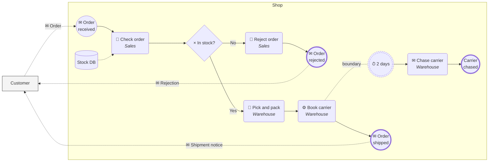

BPMN Sketch Skill, in Mermaid. Quick, Readable, Portable. Mermaid has no BPMN shapes, so this borrows flowchart shapes that look close enough to read as BPMN. It is a sketch: use the `bpmn` or `bpmn-light` skill when the diagram must be valid BPMN or open in a BPMN tool.

- **Left to right.** `flowchart LR`, happy path first, alternatives after it.
- **One pool, the rest as boxes.** Wrap the process in one `subgraph` named for its organisation. Draw each outside party as a single plain box outside it (`customer["Customer"]:::pool`). Don't nest lane subgraphs: Mermaid lays them side by side, not stacked, so put the role in the task label instead.
- **Shapes stand in for BPMN** (only old, stable syntax, so it renders on older Mermaid):

  | BPMN | Mermaid |
  |---|---|
  | start event | `id(("label")):::evStart` |
  | end event | `id(("label")):::evEnd` (thick border) |
  | intermediate event | `id((("label")))` (double circle) |
  | non-interrupting event | add `:::nonInterrupting` (dashed) |
  | task | `id("label")` |
  | sub-process / call activity | `id[["label"]]` |
  | exclusive gateway | `id{"× question?"}` |
  | parallel gateway | `id{"+"}` |
  | data store | `id[("label")]` |
  | data object | `id[/"label"/]` |

- **Type marks are a symbol at the start of the label.** Use 👤 for a user task, ⚙ for a service task, ✉ for a message, ⏱ for a timer, ⚡ for an error, and ✋ for a manual task. Leave the symbol off for a plain task.
- **Lines carry meaning.**
  - Sequence flow: `-->`.
  - Message flow (to or from another party): `-. "✉ message" .->`.
  - Data or annotation link: `-.->` with no label.
  - Boundary event: Mermaid can't attach one, so connect it with `task -. "boundary" .- event`, then let the event's own `-->` flow lead to its exception path.
- **Everything labeled, briefly.** Tasks: verb plus object, role on a second line (`"👤 Check order <i>Sales</i>"`). Events: the state reached ("Order received"). Exclusive splits: a question, with every outgoing edge labeled as an answer. Message flows: the message.
- **Honest flow.** Every path starts at a start event and ends at an end event. Close each split with the same gateway type. Keep it under about 15 tasks; push detail into a `[[sub-process]]` with its own diagram.
- **Mermaid traps.**
  - `end` is reserved: never use it as a node id or class name.
  - Quote every label that contains punctuation, ` ` or a symbol.
  - Put the `classDef` lines at the bottom.
- **Legend when the reader isn't BPMN-literate.** Add a `subgraph legend` of sample shapes linked with `~~~`, placed after the last node with `lastNode ~~~ legend`.
- **Look before you ship.** Preview it (GitHub, VS Code's Markdown preview, or mermaid.live) and reorder lines until edges stop crossing. Commit the `.mmd` (or the Markdown block) next to whatever links to it.

Template:

